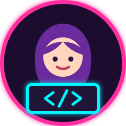

<div align="center">


<!-- Ícone animado: menina programando (arquivo avatar.svg na raiz do repositório) -->


# Portfolio — Maria Eduarda Ciarini

<a href="https://mariaeduardaciarini.github.io/PortfolioNewWithCloude/">
  
</a>

<br/><br/>

<a href="https://mariaeduardaciarini.github.io/PortfolioNewWithCloude/">
  
</a>


<br/><br/>

<!-- Menu de navegação clicável -->
<a href="#-sobre"></a>
<a href="#-formação"></a>
<a href="#-experiência"></a>
<a href="#-projetos"></a>
<a href="#-stack"></a>
<a href="#-contato"></a>

</div>


## 💡 Sobre

```bash
┌──(maria㉿dev)-[~/portfolio]
└─$ cat sobre.txt
   Formada em Análise e Desenvolvimento de Sistemas pela FIAP,
   com interesse na interseção entre tecnologia, dados,
   negócios e administração.

┌──(maria㉿dev)-[~/portfolio]
└─$ ls site/
   sobre/  formacao/  projetos/  stack/  contato/
```

Portfólio pessoal para apresentar minha trajetória, experiências profissionais, projetos e stack técnica na área de tecnologia. Reúne minha formação, experiências e projetos desenvolvidos ao longo da graduação e no mercado.

## 🎓 Formação

<details>
<summary><b>Tecnólogo em Análise e Desenvolvimento de Sistemas</b> — clique para abrir</summary>

<br/>

**FIAP** — Faculdade de Informática e Administração Paulista
📅 Conclusão: Jul 2025

</details>

## 💼 Experiência

<details open>
<summary><b>Desenvolvedora de Backend & Coordenação</b> · Jet Family Assistência Técnica <i>(Freelance, Set 2026 — atual)</i></summary>

<br/>

Supervisão do desenvolvimento do layout e estruturação da página comercial da empresa, com foco na experiência do usuário e na apresentação dos serviços. Organização estratégica de informações e elementos visuais, destacando os serviços de reparo e locação de lavadoras de alta pressão e aspiradores, para fortalecer a presença digital e facilitar a conversão de clientes.

📍 São Paulo e Região, Remoto

</details>

<details>
<summary><b>Desenvolvedora Backend Júnior</b> · Distribuidora Safari <i>(Projeto temporário)</i></summary>

<br/>

Desenvolvimento e manutenção de sistemas internos com Python e Django, banco de dados PostgreSQL e gerenciamento de ambientes com virtualenv. Criação e integração de APIs REST com bancos relacionais, automação de processos internos e organização de dados, utilizando Git/GitHub e metodologia ágil Scrum.

</details>

<details>
<summary><b>Suporte Técnico</b> · CS2 Seguros</summary>

<br/>

Atendimento e suporte técnico a clientes, auxiliando no uso dos sistemas e na resolução de dúvidas. Diagnóstico e solução de problemas de software, acesso e configurações, com registro e acompanhamento de chamados até a resolução. Organização de informações e controles administrativos com Excel, Word e Outlook.

</details>

## 🚀 Projetos

<details open>
<summary><b>📈 BTC Tracker</b> <code>app · dados em tempo real</code></summary>

<br/>

Aplicação interativa em Streamlit para acompanhar a cotação do Bitcoin em USD e BRL, visualizar o histórico dos últimos 365 dias e converter entre BTC, satoshis, USD e BRL.


</details>

<details>
<summary><b>🏢 FIIs em Tempo Real</b> <code>app · dados em tempo real</code></summary>

<br/>

Aplicação em Streamlit para consulta de cotações de Fundos Imobiliários (FIIs) em tempo real, na mesma linha do BTC Tracker.


</details>

<details>
<summary><b>🔌 Webservice NoSQL</b> <code>projeto acadêmico · API</code></summary>

<br/>

API RESTful desenvolvida com CRUD, arquitetura MVC e tratamento de exceções.


</details>

<details>
<summary><b>📱 Aplicativo Mobile</b> <code>projeto acadêmico · mobile</code></summary>

<br/>

Aplicação Android com consumo de API externa e interface construída em Jetpack Compose.


</details>

<details>
<summary><b>🕷️ Web Scraping</b> <code>projeto acadêmico · automação</code></summary>

<br/>

Automação para coleta, tratamento e exportação de dados em CSV e JSON.


</details>

## 🧰 Stack

<details open>
<summary><b>💻 Linguagens</b></summary>

<p align="center">
  <br/>
  
</p>

</details>

<details>
<summary><b>⚙️ Backend & Mobile</b></summary>

<p align="center">
  <br/>
  
  
  
</p>

</details>

<details>
<summary><b>🗄️ Banco de dados</b></summary>

<p align="center">
  
  
  
  
</p>

</details>

<details>
<summary><b>🛠️ Ferramentas & processo</b></summary>

<p align="center">
  <br/>
  
  
</p>

</details>

<details open>
<summary><b>🤖 Inteligência Artificial</b></summary>

<p align="center">
  
  
</p>

</details>

<details>
<summary><b>📋 Administrativo</b></summary>

<p align="center">
  
  
  
</p>

</details>

## 🌐 Tecnologias do site e hospedagem

```bash
$ stack --site
  HTML + CSS + JavaScript puros · sem frameworks · fontes via Google Fonts

$ deploy --target github-pages --branch main
  ✔ publicado automaticamente a cada push na branch main
```

## 📫 Contato

<div align="center">

```bash
$ ./contact --open-to "tecnologia · backend · dados"
```

<a href="mailto:mariaeduardaciarini@gmail.com">
  
</a>
<a href="https://www.linkedin.com/in/maria-eduarda-ciarini/">
  
</a>
<a href="https://github.com/MariaEduardaCiarini">
  
</a>

<br/><br/>

<a href="#portfolio--maria-eduarda-ciarini">⬆ Voltar ao topo</a>


</div>